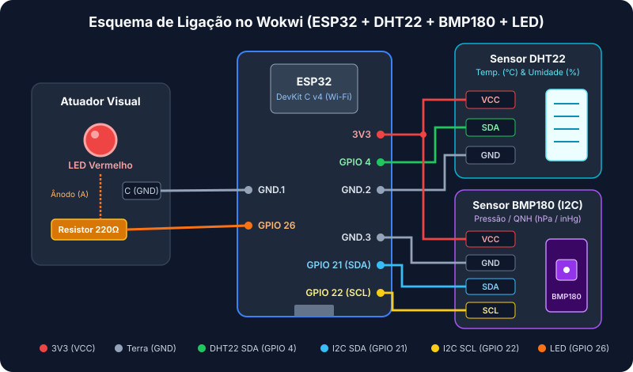
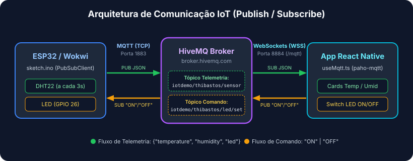

# 📱 Painel IoT — ESP32, MQTT & React Native (Expo)

---

## 🟢 1. Visão Geral do Projeto

Este projeto apresenta uma solução completa e didática de **Internet das Coisas (IoT)** que integra um microcontrolador **ESP32** (simulado no **Wokwi**) a um aplicativo móvel desenvolvido em **React Native (Expo)** utilizando o protocolo de mensageria **MQTT**.

Com esta aplicação, você é capaz de:
- **Monitorar em tempo real** a temperatura (`°C`) e a umidade relativa do ar (`%`) lidas pelo sensor **DHT22** conectado ao ESP32.
- **Controlar remotamente** um **LED físico/simulado** no pino do ESP32 diretamente pela interface do celular através de um botão `Switch`, com confirmação de estado sincronizada via telemetria.

---

## 🔌 2. Hardware e Sensores (Montagem no Wokwi)

Abaixo está o diagrama esquemático da montagem eletrônica configurada no simulador Wokwi (`wokiwi_example/diagram.json`):



### Tabela de Componentes

| Componente | Identificador (`diagram.json`) | Função no Circuito |
| :--- | :---: | :--- |
| **ESP32 DevKit v4** | `esp` (`board-esp32-devkit-c-v4`) | Microcontrolador principal com módulo Wi-Fi integrado, responsável por ler o sensor, acionar o LED e comunicar-se via MQTT. |
| **Sensor DHT22** | `dht` (`wokwi-dht22`) | Sensor digital para medição de temperatura e umidade relativa do ar. |
| **LED Vermelho + Resistor 220Ω** | `led1` (`wokwi-led`) + `r1` (`wokwi-resistor`) | Atuador para indicação visual acionado remotamente (o resistor de 220Ω limita a corrente para proteger o LED e a porta lógica). |

### Mapeamento de Pinos

As conexões físicas definidas no arquivo `wokiwi_example/diagram.json` seguem o mapeamento abaixo:

| Origem (Componente) | Pino do Componente | Destino no ESP32 | Cor do Fio | Função |
| :--- | :---: | :---: | :---: | :--- |
| **DHT22** | `VCC` | `3V3` | 🔴 Vermelho | Alimentação de 3.3V do sensor |
| **DHT22** | `SDA` | `GPIO 4` | 🟢 Verde | Linha de dados digital (leitura de temperatura/umidade) |
| **DHT22** | `GND` | `GND.2` | ⚫ Preto | Referência de terra (Ground) |
| **Resistor 220Ω (`r1`)** | Terminal `1` | `GPIO 26` | 🟠 Laranja | Saída digital de controle do LED |
| **LED Vermelho (`led1`)** | `A` (Ânodo) | Terminal `2` do Resistor `r1` | 🟠 Laranja | Entrada positiva do LED com corrente limitada |
| **LED Vermelho (`led1`)** | `C` (Cátodo) | `GND.1` | ⚫ Preto | Fechamento do circuito no terra (Ground) |

---

## 📡 3. Arquitetura de Comunicação & Interação

A comunicação entre o hardware e o aplicativo móvel utiliza o padrão **Publish/Subscribe (Publicar/Assinar)** intermediado pelo broker público **HiveMQ Cloud**.



### Funcionamento do Fluxo de Dados

1. **Telemetria (`ESP32 ➔ App`)**:
   - No firmware (`wokiwi_example/sketch.ino`), o ESP32 conecta-se ao broker `broker.hivemq.com` via **TCP na porta `1883`**.
   - A cada **3 segundos**, o microcontrolador lê os valores do sensor **DHT22** e publica um payload JSON no tópico `iotdemo/thibastos/sensor`:
     ```json
     {"temperature": 24.5, "humidity": 60.0, "led": true}
     ```
   - O aplicativo React Native, que assina (`subscribe`) esse mesmo tópico via **WebSockets Seguro (WSS) na porta `8884`**, recebe o JSON instantaneamente e atualiza os cartões na tela.

2. **Comando (`App ➔ ESP32`)**:
   - Ao acionar o componente `Switch` na tela do aplicativo (`App.tsx`), a função `setLed(value)` envia uma mensagem contendo `"ON"` ou `"OFF"` para o tópico `iotdemo/thibastos/led/set`.
   - O ESP32, que mantém uma assinatura ativa (`mqtt.subscribe`) nesse tópico de comando, dispara imediatamente a função de callback `onMessage`, alterando o nível lógico do **GPIO 26** (`HIGH` ou `LOW`) para acender ou apagar o LED.

---

## 🧠 4. Entendendo os Conceitos: HiveMQ & `useMqtt` (Analogia com Firebase)

Se você já utilizou o **Firebase** em projetos web ou mobile, entender como o **MQTT** funciona neste projeto é muito simples:

### ☁️ HiveMQ como a Cloud / Broker
O **HiveMQ Broker** funciona de forma análoga ao **Firebase Realtime Database** (ou Cloud Firestore).
- **Não existe conexão direta** (ponto a ponto) entre o celular e o ESP32 — eles sequer precisam estar na mesma rede Wi-Fi.
- Ambos se conectam ao servidor **HiveMQ na nuvem**. Quando o ESP32 quer enviar dados, ele "escreve" em um caminho (chamado de **tópico**, como `iotdemo/thibastos/sensor`), e o HiveMQ distribui essa mensagem em tempo real para todos os dispositivos que estão observando aquele caminho.

### 🪝 O Custom Hook `useMqtt.ts`
O hook personalizado `src/hooks/useMqtt.ts` age exatamente como um **listener em tempo real do Firebase** (`onValue` do Realtime Database ou `onSnapshot` do Firestore):
- Quando o componente é montado (`useEffect`), ele abre a conexão **WebSocket** com o broker e assina o tópico do sensor (`client.subscribe`).
- Sempre que uma nova mensagem chega do HiveMQ, o callback `client.onMessageArrived` é disparado automaticamente.
- Ele converte o texto JSON recebido e atualiza os estados do React (`setData`, `setLastUpdate`, `setStatus`), forçando a **re-renderização automática** dos cards de Temperatura, Umidade e estado do LED em `App.tsx`.

---

## 🚀 5. Como Executar o Projeto

### Passo 1: Rodar a Simulação do ESP32 no Wokwi
1. Acesse o simulador [Wokwi](https://wokwi.com/) (ou utilize a extensão **Wokwi Simulator** no VS Code).
2. Carregue o código do arquivo `wokiwi_example/sketch.ino` e a montagem do `wokiwi_example/diagram.json` (certifique-se de incluir as bibliotecas `PubSubClient` e `DHT sensor library`).
3. Verifique se o identificador único nos tópicos do `sketch.ino` corresponde ao `DEVICE_ID` configurado em `src/config.ts` (por padrão, `thibastos`).
4. Inicie a simulação clicando em **Start the simulation**. Você verá no Monitor Serial a conexão ao Wi-Fi `Wokwi-GUEST`, ao broker MQTT e o envio do JSON a cada 3 segundos.

### Passo 2: Iniciar o Aplicativo React Native (Expo)
No terminal, dentro da pasta `app-iot`, instale as dependências e inicie o servidor do Expo:

```bash
# 1. Instalar as dependências do projeto
npm install

# 2. Iniciar o servidor de desenvolvimento do Expo
npx expo start
```

Escaneie o QR Code exibido no terminal utilizando o aplicativo **Expo Go** no seu smartphone (Android/iOS) ou pressione `a` / `w` para abrir no emulador Android ou navegador web.
