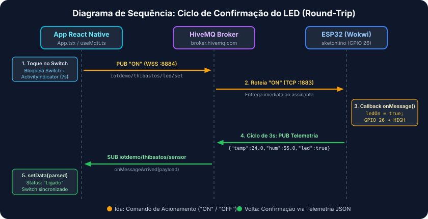

# 📱 Painel IoT — ESP32, MQTT & React Native (Expo)

---

## 🟢 1. Visão Geral do Projeto

Este é um **projeto didático desenvolvido para as aulas de Desenvolvimento Mobile com React Native integrado a IoT**, demonstrando na prática como construir interfaces móveis reativas que se comunicam bidirecionalmente com dispositivos físicos ou simulados.

A solução integra um microcontrolador **ESP32** (simulado no **Wokwi**) a um aplicativo móvel desenvolvido em **React Native (Expo)** utilizando o protocolo de mensageria **MQTT**.

Com esta aplicação, você é capaz de:
- **Monitorar em tempo real** a temperatura (`°C`) e a umidade relativa do ar (`%`) lidas pelo sensor **DHT22** conectado ao ESP32.
- **Controlar remotamente** um **LED físico/simulado** no pino do ESP32 diretamente pela interface do celular através de um botão `Switch`, com confirmação de estado sincronizada via telemetria.

---

## 🔌 2. Hardware e Sensores (Montagem no Wokwi)

Abaixo está o diagrama esquemático da montagem eletrônica configurada no simulador Wokwi (`wokiwi_example/diagram.json`):


### Tabela de Componentes

| Componente | Identificador (`diagram.json`) | Função no Circuito |
| :--- | :---: | :--- |
| **ESP32 DevKit v4** | `esp` (`board-esp32-devkit-c-v4`) | Microcontrolador principal com módulo Wi-Fi integrado, responsável por ler o sensor, acionar o LED e comunicar-se via MQTT. |
| **Sensor DHT22** | `dht` (`wokwi-dht22`) | Sensor digital para medição de temperatura e umidade relativa do ar. |
| **LED Vermelho + Resistor 220Ω** | `led1` (`wokwi-led`) + `r1` (`wokwi-resistor`) | Atuador para indicação visual acionado remotamente (o resistor de 220Ω limita a corrente para proteger o LED e a porta lógica). |

### Mapeamento de Pinos

As conexões físicas definidas no arquivo `wokiwi_example/diagram.json` seguem o mapeamento abaixo:

| Origem (Componente) | Pino do Componente | Destino no ESP32 | Cor do Fio | Função |
| :--- | :---: | :---: | :---: | :--- |
| **DHT22** | `VCC` | `3V3` | 🔴 Vermelho | Alimentação de 3.3V do sensor |
| **DHT22** | `SDA` | `GPIO 4` | 🟢 Verde | Linha de dados digital (leitura de temperatura/umidade) |
| **DHT22** | `GND` | `GND.2` | ⚫ Preto | Referência de terra (Ground) |
| **Resistor 220Ω (`r1`)** | Terminal `1` | `GPIO 26` | 🟠 Laranja | Saída digital de controle do LED |
| **LED Vermelho (`led1`)** | `A` (Ânodo) | Terminal `2` do Resistor `r1` | 🟠 Laranja | Entrada positiva do LED com corrente limitada |
| **LED Vermelho (`led1`)** | `C` (Cátodo) | `GND.1` | ⚫ Preto | Fechamento do circuito no terra (Ground) |

---

## 📡 3. Arquitetura de Comunicação & Interação

A comunicação entre o hardware e o aplicativo móvel utiliza o padrão **Publish/Subscribe (Publicar/Assinar)** intermediado pelo broker público **HiveMQ Cloud**.


### Funcionamento do Fluxo de Dados

1. **Telemetria (`ESP32 ➔ App`)**:
   - No firmware (`wokiwi_example/sketch.ino`), o ESP32 conecta-se ao broker `broker.hivemq.com` via **TCP na porta `1883`**.
   - A cada **3 segundos**, o microcontrolador lê os valores do sensor **DHT22** e publica um payload JSON no tópico `iotdemo/thibastos/sensor`:
     ```json
     {"temperature": 24.5, "humidity": 60.0, "led": true}
     ```
   - O aplicativo React Native, que assina (`subscribe`) esse mesmo tópico via **WebSockets Seguro (WSS) na porta `8884`**, recebe o JSON instantaneamente e atualiza os cartões na tela.

2. **Comando (`App ➔ ESP32`)**:
   - Ao acionar o componente `Switch` na tela do aplicativo (`App.tsx`), a função `setLed(value)` envia uma mensagem contendo `"ON"` ou `"OFF"` para o tópico `iotdemo/thibastos/led/set`.
   - O ESP32, que mantém uma assinatura ativa (`mqtt.subscribe`) nesse tópico de comando, dispara imediatamente a função de callback `onMessage`, alterando o nível lógico do **GPIO 26** (`HIGH` ou `LOW`) para acender ou apagar o LED.

### 🔄 Ciclo de Confirmação do LED (Round-Trip)

Diferente de um botão local comum, o `Switch` do aplicativo não muda de estado definitivo apenas pelo toque do usuário: ele aguarda a **confirmação real vinda do hardware** (ciclo de ida e volta / *round-trip*), conforme ilustrado no diagrama de sequência abaixo:



1. **Acionamento no App (`App.tsx`)**: O usuário toca no `Switch` ➔ O app publica `"ON"` (ou `"OFF"`) em `iotdemo/thibastos/led/set`, bloqueia temporariamente o `Switch` e exibe um `ActivityIndicator` (com *timeout* de segurança de 7 segundos).
2. **Roteamento no HiveMQ Broker**: O broker recebe o pacote via WebSocket e o encaminha instantaneamente via TCP para o ESP32.
3. **Execução no ESP32 (`sketch.ino`)**: O callback `onMessage()` captura o comando, coloca o pino `GPIO 26` em nível `HIGH` (ou `LOW`) e atualiza a variável de estado `ledOn = true`.
4. **Confirmação via Telemetria**: No próximo ciclo de leitura (a cada 3s), o ESP32 publica o JSON atualizado `{"temperature": ..., "humidity": ..., "led": true}` em `iotdemo/thibastos/sensor` ➔ O HiveMQ entrega ao App ➔ A interface atualiza o status visual para `"Ligado"` com o estado real confirmado pelo microcontrolador.

### 🔌 Por que usamos Portas Diferentes? (`1883` TCP vs. `8884` WSS)

| Dispositivo | Protocolo de Transporte | Porta | Motivo Técnico |
| :--- | :---: | :---: | :--- |
| **ESP32 (Wokwi)** | **MQTT sobre TCP puro** | `1883` | Microcontroladores em C/C++ (`WiFiClient` + `PubSubClient`) possuem acesso direto à pilha de sockets TCP nativos do sistema embarcado, permitindo conexões leves e com baixíssimo consumo de memória RAM. |
| **App React Native (Expo)** | **MQTT sobre WebSockets Seguro (WSS)** | `8884` | O runtime JavaScript mobile (**Hermes** no React Native) e os navegadores web não expõem sockets TCP brutos por questões de segurança e arquitetura. Por isso, a biblioteca `paho-mqtt` encapsula os pacotes MQTT dentro de uma conexão **WebSocket com criptografia TLS/SSL (`wss://`)** na porta `8884` (caminho `/mqtt`). |

---

## 🧠 4. Entendendo os Conceitos: HiveMQ & `useMqtt` (Analogia com Firebase)

Se você já utilizou o **Firebase** em projetos web ou mobile, entender como o **MQTT** funciona neste projeto é muito simples:

### ☁️ HiveMQ como a Cloud / Broker
O **HiveMQ Broker** funciona de forma análoga ao **Firebase Realtime Database** (ou Cloud Firestore).
- **Não existe conexão direta** (ponto a ponto) entre o celular e o ESP32 — eles sequer precisam estar na mesma rede Wi-Fi.
- Ambos se conectam ao servidor **HiveMQ na nuvem**. Quando o ESP32 quer enviar dados, ele "escreve" em um caminho (chamado de **tópico**, como `iotdemo/thibastos/sensor`), e o HiveMQ distribui essa mensagem em tempo real para todos os dispositivos que estão observando aquele caminho.

### 🪝 O Custom Hook `useMqtt.ts`
O hook personalizado `src/hooks/useMqtt.ts` age exatamente como um **listener em tempo real do Firebase** (`onValue` do Realtime Database ou `onSnapshot` do Firestore):
- Quando o componente é montado (`useEffect`), ele abre a conexão **WebSocket** com o broker e assina o tópico do sensor (`client.subscribe`).
- Sempre que uma nova mensagem chega do HiveMQ, o callback `client.onMessageArrived` é disparado automaticamente.
- Ele converte o texto JSON recebido e atualiza os estados do React (`setData`, `setLastUpdate`, `setStatus`), forçando a **re-renderização automática** dos cards de Temperatura, Umidade e estado do LED em `App.tsx`.

### 🗂️ O que é um Broker MQTT e como funcionam os Tópicos?

No protocolo **MQTT**, os dispositivos não precisam conhecer o endereço IP uns dos outros. Toda a comunicação passa pelo **Broker**, que atua como uma central de correios inteligente baseada no modelo **Publish/Subscribe (Publicar/Assinar)**:
- **Publisher (Publicador)**: Quem envia a mensagem para um tópico (ex.: o ESP32 publicando a leitura do DHT22).
- **Subscriber (Assinante)**: Quem registra interesse em receber mensagens de um tópico (ex.: o app React Native escutando as atualizações do sensor).

Os **Tópicos MQTT** são endereços organizados em uma **estrutura hierárquica separada por barras (`/`)**, semelhante a pastas de arquivos ou rotas de uma URL:

```text
iotdemo / thibastos / sensor
└──┬──┘   └───┬───┘   └──┬─┘
Projeto   DEVICE_ID    Recurso/Canal (sensor ou led/set)
```

> ⚠️ **Importante — Evitando Colisão de Dados em Sala de Aula (`DEVICE_ID`)**:  
> Como o `broker.hivemq.com` é um servidor **público e compartilhado mundialmente**, se dois alunos utilizarem exatamente o mesmo tópico ao mesmo tempo, um aplicativo receberá os dados do ESP32 do colega (colisão de tópicos). Para isolar o seu experimento, altere o identificador `DEVICE_ID` (ex.: `thibastos` para o seu nome ou matrícula) simultaneamente nos dois arquivos:
> - No aplicativo mobile: [`src/config.ts`](./src/config.ts) (`const DEVICE_ID = 'seu_id_unico';`)
> - No firmware do ESP32: [`wokiwi_example/sketch.ino`](./wokiwi_example/sketch.ino) (`TOPIC_SENSOR` e `TOPIC_LED_SET`)

---

## 📱 5. Conceitos de Programação Mobile Aplicados

O código do aplicativo foi estruturado seguindo boas práticas modernas de engenharia de software para **React Native com TypeScript**:

### 1. Separação de Responsabilidades (*Separation of Concerns — SoC*)
O projeto divide claramente o papel de cada arquivo para facilitar a manutenção e o reaproveitamento:
- **Configuração ([`src/config.ts`](./src/config.ts))**: Centraliza constantes de infraestrutura (`host`, `port`, `path`, `DEVICE_ID` e nomes dos tópicos), evitando valores fixos (*magic strings*) espalhados pelo código.
- **Camada de Rede e Estado ([`src/hooks/useMqtt.ts`](./src/hooks/useMqtt.ts))**: Encapsula toda a complexidade do protocolo MQTT (`paho-mqtt`) dentro de um *Custom Hook*, expondo uma interface limpa e fortemente tipada em TypeScript (`SensorData` e `ConnectionStatus`).
- **Camada Visual ([`App.tsx`](./App.tsx))**: Foca exclusivamente na apresentação visual (JSX e `StyleSheet`) e na interação com o usuário, consumindo apenas `{ status, data, lastUpdate, setLed }` fornecidos pelo hook.

### 2. Ciclo de Vida e Prevenção de *Memory Leaks*
Conexões em tempo real exigem controle rigoroso do ciclo de vida dos componentes no React Native:
- **Persistência com `useRef`**: A instância do cliente MQTT (`clientRef`) é armazenada em um `useRef` em vez de um `useState`. Isso garante que o objeto de conexão persista entre renderizações sem disparar ciclos de re-renderização desnecessários na árvore de componentes.
- **Limpeza (*Cleanup*) no `useEffect`**: O `useEffect` que inicializa a conexão retorna uma função de limpeza (`return () => { if (client.isConnected()) client.disconnect(); }`). Quando o componente é desmontado, a conexão WebSocket é encerrada graciosamente, prevenindo vazamentos de memória (*memory leaks*) e conexões "zumbis".

### 3. UX Resiliente em Redes IoT
Em sistemas de Internet das Coisas, comandos enviados pela rede possuem latência física e dependem do ciclo de resposta do microcontrolador:
- Ao tocar no `Switch`, o aplicativo exibe um **`ActivityIndicator`** e desabilita temporariamente novos toques (`disabled={status !== 'connected' || showIndicator}`).
- Um temporizador de segurança (`setTimeout` de **7 segundos** gerenciado via `useEffect`) garante que a interface nunca fique travada permanentemente e evita que o usuário dispare múltiplos comandos conflitantes antes que o ESP32 confirme a mudança de estado no ciclo de telemetria.

---

## 🚀 6. Como Executar o Projeto

### Passo 1: Rodar a Simulação do ESP32 no Wokwi
1. Acesse o simulador [Wokwi](https://wokwi.com/) (ou utilize a extensão **Wokwi Simulator** no VS Code).
2. Carregue o código do arquivo `wokiwi_example/sketch.ino` e a montagem do `wokiwi_example/diagram.json` (certifique-se de incluir as bibliotecas `PubSubClient` e `DHT sensor library`).
3. Verifique se o identificador único nos tópicos do `sketch.ino` corresponde ao `DEVICE_ID` configurado em `src/config.ts` (por padrão, `thibastos`).
4. Inicie a simulação clicando em **Start the simulation**. Você verá no Monitor Serial a conexão ao Wi-Fi `Wokwi-GUEST`, ao broker MQTT e o envio do JSON a cada 3 segundos.

### Passo 2: Iniciar o Aplicativo React Native (Expo)
No terminal, dentro da pasta `app-iot`, instale as dependências e inicie o servidor do Expo:

```bash
# 1. Instalar as dependências do projeto
npm install

# 2. Iniciar o servidor de desenvolvimento do Expo
npx expo start
```

Escaneie o QR Code exibido no terminal utilizando o aplicativo **Expo Go** no seu smartphone (Android/iOS) ou pressione `a` / `w` para abrir no emulador Android ou navegador web.
